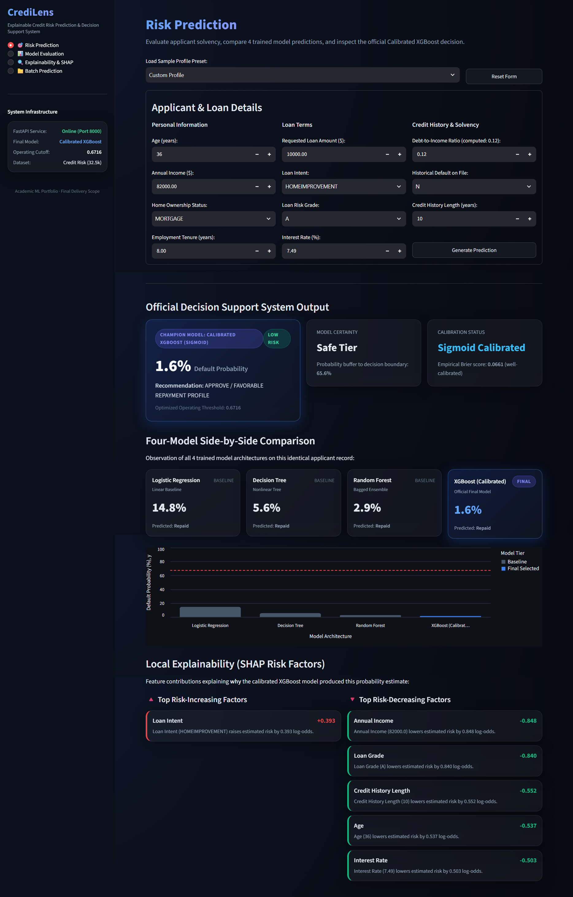
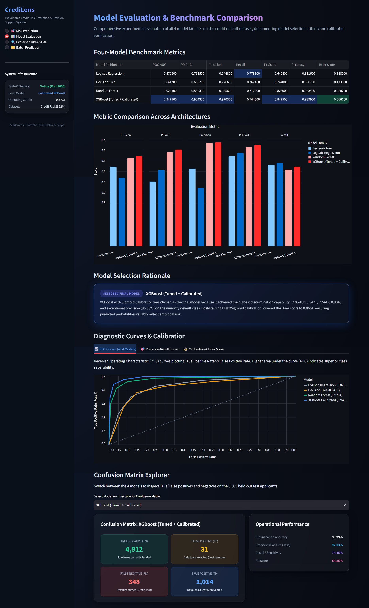
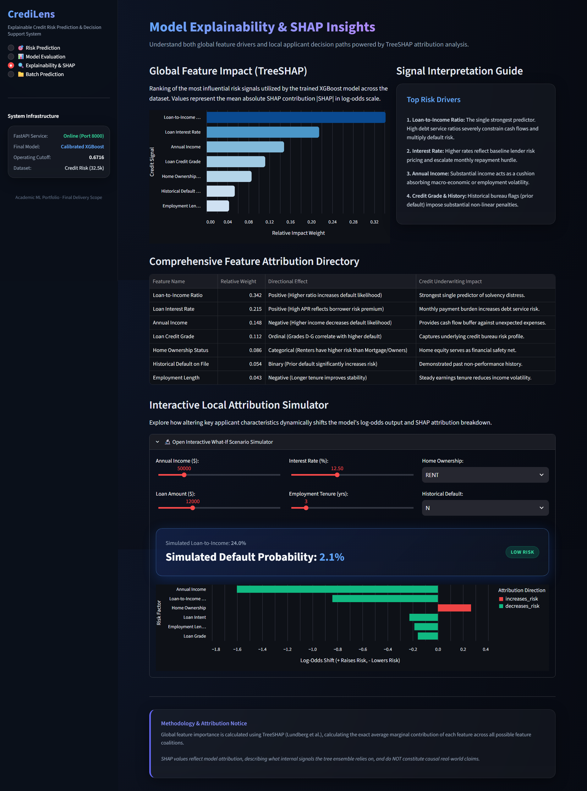

# CrediLens

**Explainable credit risk prediction and decision support.** CrediLens scores loan applicants for default risk, compares four trained models on the same record, and explains each prediction with TreeSHAP. A FastAPI service handles inference and a Streamlit dashboard sits on top of it.


<p align="center">
  
</p>

---

## Contents

- [Key features](#key-features)
- [Screenshots](#screenshots)
- [Machine learning workflow](#machine-learning-workflow)
- [Model results](#model-results)
- [Explainability](#explainability)
- [Architecture](#architecture)
- [Tech stack](#tech-stack)
- [Getting started](#getting-started)
- [API reference](#api-reference)
- [Input schema](#input-schema)
- [Project structure](#project-structure)
- [Testing](#testing)
- [Scope and limitations](#scope-and-limitations)
- [Possible improvements](#possible-improvements)

---

## Key features

| Area | What it does |
| :--- | :--- |
| **Risk prediction** | Form for 11 applicant and loan attributes with input validation and three preset profiles (prime low-risk, borderline moderate-risk, high-risk). Returns a default probability, an approve/deny recommendation, a risk tier and the distance to the decision threshold. |
| **Model comparison** | Shows default probabilities from Logistic Regression, Decision Tree, Random Forest and the calibrated XGBoost model for the same applicant. |
| **Local explanations** | Lists the top risk-increasing and risk-decreasing features for a prediction, with SHAP contributions in log-odds. |
| **Model evaluation** | Benchmark table, grouped metric chart, ROC / precision-recall / calibration tabs, a selection rationale and a per-model confusion matrix explorer. |
| **Global explainability** | Feature importance ranking, an attribution directory with plain-language underwriting notes, and a what-if simulator. |
| **Batch scoring** | Upload a CSV, score every row with the final model, view portfolio summary statistics and download the scored file. A sample template and a one-click 10-applicant test run are included. |
| **REST API** | Pydantic v2 request and response schemas, plus Swagger and ReDoc docs. |
| **Fallback mode** | The dashboard calls the API over HTTP when it is running and falls back to in-process inference when it is not. |

---

## Screenshots

### Risk prediction
Decision card, four-model comparison and local SHAP factors for a single applicant.

<p align="center">
  
</p>

### Model evaluation
Benchmark metrics, ROC curves, selection rationale and confusion matrix explorer.

<p align="center">
  
</p>

### Explainability and what-if simulator
Global TreeSHAP ranking, attribution directory and the interactive simulator.

<p align="center">
  
</p>

---

## Machine learning workflow

1. **Data.** Structured credit-risk data of about 32.5k applicants with 11 input features (see [Input schema](#input-schema)). Roughly 22% of records are defaults, so the classes are imbalanced. Evaluation uses a held-out test set of 6,305 applicants.
2. **Preprocessing.** A scikit-learn `ColumnTransformer` pipeline with imputation and one-hot encoding of categorical fields, bundled with the model so inference applies the same transformations as training.
3. **Models.** Logistic Regression, Decision Tree and Random Forest as baselines, and a tuned XGBoost classifier as the candidate final model.
4. **Calibration.** The XGBoost model is wrapped with sigmoid (Platt) calibration so its outputs behave as probabilities. Reliability curves and Brier score are shown on the evaluation page.
5. **Decision threshold.** A tuned operating cutoff of **0.6716** is stored separately from the model. An applicant is flagged as a predicted default when the calibrated probability is at or above it.
6. **Explainability.** TreeSHAP attributions are computed for the XGBoost model, locally per applicant and globally across the dataset.
7. **Serving.** The pipeline, threshold and cached baseline models are loaded once at API startup and shared by the API and the dashboard.

---

## Model results

Evaluated on 6,305 held-out applicants. The best value in each column is in bold.

| Model | ROC-AUC | PR-AUC | Precision | Recall | F1 |
| :--- | :---: | :---: | :---: | :---: | :---: |
| **XGBoost (tuned + sigmoid-calibrated)** — final model | **0.9471** | **0.9043** | **0.9703** | 0.7445 | **0.8425** |
| Random Forest | 0.9284 | 0.8803 | 0.9656 | 0.7172 | 0.8230 |
| Decision Tree | 0.8417 | 0.6052 | 0.7266 | 0.7624 | 0.7440 |
| Logistic Regression | 0.8705 | 0.7135 | 0.5448 | **0.7781** | 0.6408 |

The calibrated XGBoost model has a Brier score of 0.0661.

**Why XGBoost was selected.** It has the best ranking quality (ROC-AUC, PR-AUC), the highest precision and F1 score, and sigmoid calibration gives it well-behaved probabilities, which matters for a risk score. It achieves 94% accuracy and an F1 score of 0.84 at its optimal operating threshold (0.6716). The confusion matrix explorer on the evaluation page shows the counts for each model.

---

## Explainability

- **Local:** each prediction returns the strongest risk-increasing and risk-decreasing features with their SHAP contributions in log-odds.
- **Global:** a ranking of features by mean absolute SHAP value, with a short underwriting interpretation of each (for example, how loan-to-income ratio and interest rate affect repayment burden).
- **What-if simulator:** change income, loan amount, interest rate, employment tenure, home ownership or default history and see the simulated probability and attribution chart update.

SHAP values describe what the trained model relies on. They are not causal claims about borrowers.

---

## Architecture

```
Streamlit dashboard  ──(HTTP JSON, or in-process fallback)──▶  FastAPI service  ──▶  Inference engine
 - Risk prediction                                              - /predict                - Preprocessing + calibrated XGBoost
 - Model evaluation                                             - /batch-predict           - Baseline models (LR, DT, RF)
 - Explainability & SHAP                                        - /evaluation              - TreeSHAP attributions
 - Batch prediction                                             - /explainability          - Threshold decision (0.6716)
```

The root `app.py` delegates to `app.frontend.streamlit_app.main()`, and `main.py` starts the API.

---

## Tech stack

| Layer | Tools |
| :--- | :--- |
| Language | Python 3.10+ |
| Modeling | XGBoost, scikit-learn (preprocessing pipeline, Logistic Regression, Decision Tree, Random Forest, calibration) |
| Explainability | SHAP (TreeSHAP) |
| API | FastAPI, Pydantic v2 |
| Frontend | Streamlit, Altair charts, custom CSS theme |
| Testing | Python `unittest` |

Exact package versions are pinned in `requirements.txt`.

---

## Getting started

**Prerequisites:** Python 3.10 or newer and Git.

```bash
git clone https://github.com/dheerajrai-dev/Credlen.git
cd Credlen

python -m venv .venv
# Windows PowerShell
.\.venv\Scripts\Activate.ps1
# Linux / macOS
source .venv/bin/activate

pip install -r requirements.txt
```

**Start the API** (optional, the dashboard falls back to in-process inference without it):

```bash
python main.py
```

The API runs at `http://127.0.0.1:8000`, with Swagger UI at `/docs` and ReDoc at `/redoc`.

**Start the dashboard** in a second terminal:

```bash
streamlit run app.py
```

Open `http://localhost:8501`. The sidebar shows whether the FastAPI service is online.

An `.env.example` template is included in the repository root.

---

## API reference

| Method | Endpoint | Purpose |
| :--- | :--- | :--- |
| `GET` | `/health` | Service status, whether the model is loaded, model name, threshold |
| `GET` | `/model-info` | Model metadata |
| `POST` | `/predict` | Score one applicant |
| `POST` | `/batch-predict` | Score a CSV of applicants (also available as `/predict-batch`) |
| `GET` | `/evaluation` | Benchmark metrics used by the evaluation page |
| `GET` | `/explainability` | Global TreeSHAP importance data |

### Score a single applicant

```bash
curl -X POST "http://127.0.0.1:8000/predict" \
     -H "Content-Type: application/json" \
     -d '{
       "person_age": 36,
       "person_income": 82000.0,
       "person_home_ownership": "MORTGAGE",
       "person_emp_length": 8.0,
       "loan_intent": "HOMEIMPROVEMENT",
       "loan_grade": "A",
       "loan_amnt": 10000.0,
       "loan_int_rate": 7.49,
       "loan_percent_income": 0.12,
       "cb_person_default_on_file": "N",
       "cb_person_cred_hist_length": 10
     }'
```

The response contains `applicant_data`, `predictions` (one probability per model), `final_model` and `top_factors`. The `final_model` block for this applicant, abridged:

```json
{
  "name": "Calibrated XGBoost (Sigmoid)",
  "probability": 0.0159,
  "threshold": 0.6716,
  "decision": "Repaid",
  "risk_band": "Low"
}
```

### Score a CSV

```bash
curl -X POST "http://127.0.0.1:8000/batch-predict" -F "file=@applicants.csv"
```

The CSV needs the 11 columns listed below. A template can be downloaded from the Batch Prediction page. The response reports total records, predicted defaults and repayments, default rate, average risk and per-row results.

---

## Input schema

| Field | Type | Valid values | Description |
| :--- | :---: | :--- | :--- |
| `person_age` | int | 18 – 100 | Age in years |
| `person_income` | float | 1,000 – 2,000,000 | Annual income (USD) |
| `person_home_ownership` | str | `RENT`, `MORTGAGE`, `OWN`, `OTHER` | Housing status |
| `person_emp_length` | float | 0 – 60 | Employment length in years |
| `loan_intent` | str | `PERSONAL`, `EDUCATION`, `MEDICAL`, `VENTURE`, `HOMEIMPROVEMENT`, `DEBTCONSOLIDATION` | Loan purpose |
| `loan_grade` | str | `A` – `G` | Loan risk grade |
| `loan_amnt` | float | 500 – 50,000 | Requested amount (USD) |
| `loan_int_rate` | float | 1.0 – 40.0 | Annual interest rate (%) |
| `loan_percent_income` | float | 0.0 – 1.5 | Loan amount divided by income |
| `cb_person_default_on_file` | str | `Y`, `N` | Prior default on credit record |
| `cb_person_cred_hist_length` | int | 0 – 50 | Credit history length in years |

---

## Project structure

```text
Credlen/
├── app.py                      # Streamlit entrypoint
├── main.py                     # FastAPI entrypoint
├── app/
│   ├── api/                    # FastAPI app, lifespan, dependencies, routes/prediction.py
│   ├── frontend/               # streamlit_app.py, api_client.py, styles.py, views/
│   │   └── views/              # prediction, evaluation, explainability, batch pages
│   ├── services/               # prediction_service.py (inference and SHAP)
│   ├── schemas/                # Pydantic request/response models (credit.py)
│   └── core/                   # config.py, exceptions.py
├── models/                     # Credit_risk_model.pkl, best_threshold.pkl, baselines.joblib
├── tests/                      # API, frontend, service, adversarial and stress tests
├── screenshots/                # screenshots
├── requirements.txt
└── .env.example
```

---

## Testing

```bash
python -m unittest discover tests -v
```

| Module | Tests | Covers |
| :--- | :---: | :--- |
| `test_api.py` | 12 | All endpoints, input validation (422 responses), CSV extension handling |
| `test_frontend.py` | 5 | API client, health probe, predict and batch flows, `main()` entrypoint |
| `test_services.py` | 5 | Engine startup, single and batch scoring, baseline comparison, SHAP |
| `test_m2_adversarial.py` | 4 | Boundary values, extreme inputs, malformed payloads |
| `test_stress_batch.py` | 8 | 500-row batch, empty, header-only, malformed and non-numeric CSVs |

---

## Scope and limitations

CrediLens is an academic portfolio project built on a single public-style tabular dataset. It has not been validated for real lending decisions, and no fairness or bias audit has been done. The 0.6716 threshold is tuned for this dataset and would need to be re-derived for any other population or cost trade-off.

---

## Possible improvements

These are not implemented.

- Include the training and tuning code in the repository so the models can be rebuilt end to end.
- Add a fairness and subgroup performance analysis.
- Containerize the API and dashboard and run the tests in CI.
- Monitor input drift and recalibrate periodically.